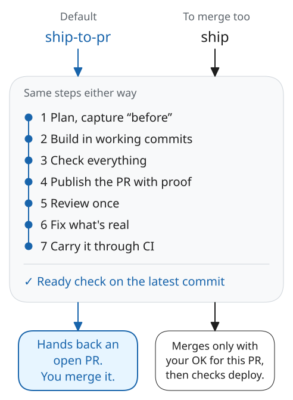

# dakstack

Dakstack is 62 skills for building, reviewing, and shipping with Claude Code
and Codex, with extras in [T3 Code](https://t3.codes). I started it with the
instructions I kept repeating across about 6,900 prompts.

The easiest way in is a local [Executor](https://executor.sh) app that reads
the skills straight from this repo, so updates show up on their own.

**[Install with Executor](#install)** · [All 62 skills](#skills) ·
[Credits](#credits-and-licenses)

## How shipping works

`ship-to-pr` and `ship` run the same steps. The only difference is where
they stop.

<picture>
  <source media="(prefers-color-scheme: dark)" srcset="assets/ship-entrypoints-dark.svg">
  
</picture>

- **`ship-to-pr` is the default.** It never merges, turns on auto-merge or
  joins a merge queue.
- **`ship` needs your go-ahead for that PR.** Saying "ship" picks where it
  stops; it isn't permission to merge.
- **PR steps need your permission.** Local work still runs its own checks.

<details>
<summary><b>Which skills run at each step, and why</b></summary>
<br>

<picture>
  <source media="(prefers-color-scheme: dark)" srcset="assets/ship-workflow-dark.svg">
  
</picture>

Why each one is there:

- **`docs-context`** grounds the work in the docs that apply and what you
  actually observe.
- **`pr-proof`** records "before" at the start and "after" on the final
  commit, so the PR shows the change.
- **`replicate-issue`** reproduces a bug before anyone fixes it, then proves
  each review finding is real and matches what the product should do.
- **`emil-design-eng`** picks only the UI specialists a task needs.
- **`improve`** audits and plans improvement work without editing code.
- **`principle-sequence-verifiable-units`** makes every commit a complete,
  working step with its tests.
- **`fanout`** gives each independent piece its own delegate, worktree and
  PR.
- **`break-ui`** tries the real UI with awkward data before any UI change, or
  UI fix, counts as done.
- **`pr-this`** writes the PR title and body from the full diff.
- **`bar`** reviews once for bugs, maintainability, tests, proof and needless
  comments. It turns findings into lint rules where they’re safe to automate.
- **`babysit-pr`** fixes real check failures and bot findings until the PR is
  ready, or merged if you asked.
- **The ready check** confirms the branch is up to date, checks pass, proof
  covers the latest commit and nothing is blocking.

Full rules: [shared workflow](skills/ship-to-pr/references/workflow.md) ·
[steps and stops](skills/ship-to-pr/references/shipping.md). Editable
diagrams: [overview](assets/ship-entrypoints.excalidraw) ·
[skills by step](assets/ship-workflow.excalidraw).

</details>

## Install

Pick one:

- **[Local Executor](#recommended-local-executor)** (recommended): one MCP
  connection for all your apps, and skill updates arrive on their own. Add
  [picker sync](#show-executor-skills-in-my-skills) to see them in My Skills.
- **[MCP server from GitHub](#mcp-server-from-github)**: no Executor needed.
  Pin a commit or tag; change it and restart to update.
- **[Native skill folders](#native-skill-folders)**: skills show up in each
  agent's own skill picker. Rerun the install to update.

### Recommended: local Executor

[Executor](https://executor.sh) runs on your machine and gives your agents
one MCP connection to all your apps. Dakstack becomes a small skills-only app
inside it.

1. Install and start Executor with its
   [command-line guide](https://executor.sh/docs/run/cli), for example
   `npm i -g executor@beta`, then run `executor` to open the dashboard.
2. Connect your agent from the dashboard's **Connect** card. Clients that
   start a command use `executor mcp` (Claude Code:
   `claude mcp add executor -- executor mcp`).
3. Paste this prompt into that agent:

```text
Using Executor, create a local skills-only app named "Dakstack" with the slug
"dakstack". Read Executor's app-authoring skill first. The app has no tools;
it only serves skills from the skills folder of the dakdevs/dakstack GitHub
repo using Executor's dynamicSkills and githubSkills helpers:

  import { defineApp, dynamicSkills } from "apps";
  import { githubSkills } from "apps/skills";

  export default defineApp({}, async (ctx) => ({
    dynamicSkills: dynamicSkills({
      list: () =>
        githubSkills({
          repo: "dakdevs/dakstack",
          path: "skills",
          fetch: ctx.fetch,
          signal: ctx.signal,
          cache: ctx.cache,
        }),
    }),
  }));

Deploy it locally. Then verify it by calling
skills({ app: "dakstack", name: "ship-to-pr" }) and confirming it returns the
ship-to-pr SKILL.md. Using the version and revision from that response, read
its references/workflow.md file. Report the app slug, version and revision.
Do not publish the app anywhere.
```

Then ask for a skill by name, for example "use dakstack's `ship-to-pr`". To
read a skill's linked files, the agent passes the file path plus the
`version` and `revision` it got back with the skill.

**Updates:** skill changes pushed to this repo come through on their own. The
app is local to your Executor, not a public listing, and you only redeploy it
if you change the app's own code.

#### Show Executor skills in My Skills

MCP lets your agent load skills by name. **My Skills** reads local skill
folders. A local sync gives you both. Executor stays the source, and the
sync puts complete skill bundles where your picker can find them.

On macOS, a login job can check Executor every 15 minutes. It verifies each
new revision before switching to it and keeps the last working copy if an
update fails. If an open session still shows the old list, refresh its skill
catalog or start a new session.

<details>
<summary>Set up picker sync with your agent</summary>

Finish the local Executor setup above, then paste this into an agent running
on the same machine:

```text
Set up Dakstack in my native skill picker and keep it in sync with my local
Executor. Use an authenticated local Executor connection that works without
an open agent session. Keep credentials out of the sync script and its logs.

List the catalog with skills({ app: "dakstack" }). Download every skill and
its listed files from the same version and revision, including references
and agent prompts. Stage and verify the entire revision before switching
to it. If a refresh fails, keep the last working revision available.

Link the synced skills into the skill folders my agents already use. Use
~/.agents/skills if my agents share it. Keep unrelated skills and local
customizations. If Dakstack is already installed, back up its existing
copies and verify there is just one picker entry for each synced skill.

Run the sync now. On macOS, set up a per-user login job that runs at login
and every 15 minutes. Verify the background job works, the picker discovers
the synced skills, and a failed refresh leaves the previous copy usable.
Tell me where the sync script and logs are and which pickers you verified.
```

</details>

### MCP server from GitHub

Any MCP client can run this repo's own server over **stdio**. You need
Node.js 22+ and npm.

```bash
npx -y git+https://github.com/dakdevs/dakstack.git
```

The server has two tools, `list_skills` and `get_skill`, so you can ask for
`ship-to-pr` and its `references/workflow.md`. It works separately from your
client's own skill picker. In Capy, add a **STDIO** server with command `npx`
and arguments `-y` and `git+https://github.com/dakdevs/dakstack.git`; it runs
on the thread's machine.

- **Pin:** add `#<commit-sha>` or `#<tag>` to the URL. Without one you get
  the default branch.
- **Update:** point the URL at the commit or tag you want, then restart the
  server or start a new session. A new pin also skips npm's cached copy.
- **Install once per machine:** run the commands below and point your client
  at the installed command. Rerun the install to update.

```bash
npm install -g git+https://github.com/dakdevs/dakstack.git
dakstack-mcp
```

### Native skill folders

This copies the skills into your agents' own skill folders. With
[skills.sh](https://skills.sh), run `bunx skills add dakdevs/dakstack` and
check its options if you use more than one agent.

<details>
<summary>Or have an agent install one shared copy for every provider</summary>

Paste this into an agent with file and network access:

```text
Install or update dakstack from https://github.com/dakdevs/dakstack using the
latest merged main revision. Find every installed agent provider and its real
global skill paths, including Codex, Claude Code, Cursor, Grok, and the
providers T3 Code uses. Read their instructions before changing anything.

Fetch a clean copy of that revision and verify its pinned upstream manifests.
Install every directory under skills/, with all references, agent prompts and
metadata, into ~/.agents/skills as the shared copy. Update existing dakstack
skills. Keep unrelated skills, provider settings, credentials and personal
AGENTS.md model preferences. Back up any installed dakstack file that differs
before replacing it, so local customizations can be recovered. Don't delete
unrelated or renamed skills without checking who owns them.

Point each provider's skill discovery at the shared copy. Reuse existing
links; where a provider needs its own skill folder, link individual dakstack
skills without replacing that folder or anything else in it. Check what each
provider supports instead of guessing paths.

Verify every installed file against the fetched revision, check links and
bundled files for every provider, and check discovery where you can. Report
the installed revision, providers verified, backups, and anything unsupported
or unverified. Say which sessions need a restart. Don't merge or publish
anything for this install.
```

</details>

**Updates:** run the same command or prompt again, then restart your agent
sessions. Upgrading from an old version? Install `ship` and `ship-to-pr`
first, then back up and remove the old Kitchen Mode, taste and
effect-boundary skill folders and their links, and update any personal
shortcuts that used those names.

## Skills

"Original" means I wrote it. Everything else names the stack it came from.
"Exact copy" files are kept byte-for-byte; "adapted" ones were rewritten for
this stack.

### Workflows

| Skill         | Say                           | What it does                                                                                       | Source                                                                                                                                                                            |
| ------------- | ----------------------------- | -------------------------------------------------------------------------------------------------- | --------------------------------------------------------------------------------------------------------------------------------------------------------------------------------- |
| `ship`        | "ship it", "get it merged"    | Builds, checks, reviews and publishes a PR, then merges only with your go-ahead for that PR.       | Original. Folds in Theo's tstack full-send (workflow, proof rules, merge gate) and the merge-conflict rules from Cursor's cursor-team-kit fix-merge-conflicts.                    |
| `ship-to-pr`  | "ship to PR"                  | Same work as `ship`, but stops with the PR open for you to merge.                                  | Original. Folds in Theo's tstack full-stop (no-merge rules, handoff states). Its shared workflow and roles adapt ideas from pstack's poteto-agent, poteto-mode and comment-sicko. |
| `bar`         | "make sure it passes the bar" | Reviews finished work in one focused pass, checks each finding, and turns repeat checks into lint. | Original.                                                                                                                                                                         |
| `show-me`     | "show me"                     | Takes real desktop and mobile screenshots and videos, and sends them to the PR, your phone or Dia. | Original.                                                                                                                                                                         |
| `design-loop` | "design it in Paper"          | Studies references, prototypes in Paper, applies your notes literally, and builds after you OK it. | Original.                                                                                                                                                                         |
| `fanout`      | "use Opus delegates"          | Gives each independent piece of work its own delegate, worktree and PR, stacked when they depend.  | Original. Handoff notes adapted from Matt Pocock's handoff skill.                                                                                                                 |
| `status`      | "what's next?"                | Checks git, PRs, deploys and threads, then tells you where things stand and what to do next.       | Original. Handoff notes adapted from Matt Pocock's handoff skill.                                                                                                                 |
| `prod-triage` | "look at the prod errors"     | Ranks Sentry and log errors by severity, then fixes each real one at its cause in its own PR.      | Original. Reproduce-first loop adapted from Matt Pocock's diagnose skill (now diagnosing-bugs).                                                                                   |
| `scaffold`    | "set up a new repo"           | Starts a project with Bun, Turborepo, Effect, oxlint, oxfmt, and CI that deploys on merge.         | Original.                                                                                                                                                                         |
| `sweep`       | "free up space"               | Finds what's filling your disk, proves what's unused, and deletes only that.                       | Original.                                                                                                                                                                         |
| `film`        | "make a launch video"         | Plans, generates, edits and critiques a product film, sending each cut to your phone.              | Original.                                                                                                                                                                         |

### Commands

| Skill                                | What it does                                                                                                          | Source                                                                                               |
| ------------------------------------ | --------------------------------------------------------------------------------------------------------------------- | ---------------------------------------------------------------------------------------------------- |
| `improve`                            | Audits a codebase and writes self-contained improvement plans for other agents. Never edits code.                     | Exact copy from [shadcn/improve](https://github.com/shadcn/improve).                                 |
| `pr-this`                            | Creates or updates the PR for the current branch, rewriting the title and body from the full diff.                    | Original.                                                                                            |
| `babysit-pr`                         | Watches a PR through CI and review bots, fixing real failures and findings at their cause.                            | Adapted from Theo's [tstack](https://github.com/t3dotgg/tstack) babysit-pr, without its wait script. |
| `thermo-nuclear-review`              | Deep audit of a branch for bugs, breaking changes, security holes and feature-gate leaks.                             | Exact copy from Cursor's thermos plugin.                                                             |
| `thermo-nuclear-code-quality-review` | Very strict maintainability review: bad abstractions, giant files, tangled conditions.                                | Exact copy from Cursor's cursor-team-kit plugin.                                                     |
| `best-practices`                     | Researches current, version-specific docs and the repo's conventions before writing code.                             | Original.                                                                                            |
| `docs-context`                       | Grounds investigation, building and review in the docs that apply and what you actually observe.                      | Original.                                                                                            |
| `unslop`                             | Removes AI-sounding patterns from writing while keeping its meaning, evidence and format.                             | Adapted from pstack's unslop.                                                                        |
| `no-comments`                        | Finds needless source comments and workarounds hidden behind them, as part of a review.                               | Adapted from pstack's no-comments.                                                                   |
| `replicate-issue`                    | Reproduces a bug or review finding, checks what the product should do, then guides a tested fix.                      | Original.                                                                                            |
| `excalidraw`                         | Creates and reviews diagrams and slides, then checks the rendered result for overlap, clipped labels and readability. | Original.                                                                                            |
| `pr-proof`                           | Captures comparable before-and-after evidence for every PR and refreshes it when the PR changes.                      | Original.                                                                                            |

### UI and motion

All adapted from [Emil Kowalski's skills](https://github.com/emilkowalski/skills)
(MIT). Dakstack adds the UI check gate and routing.

| Skill                          | What it does                                                                          | Source                      |
| ------------------------------ | ------------------------------------------------------------------------------------- | --------------------------- |
| `break-ui`                     | Tests built UI with realistic, awkward data and real rendering and interactions.      | Adapted from Emil Kowalski. |
| `emil-design-eng`              | Applies shared UI rules and picks which UI specialists a task needs.                  | Adapted from Emil Kowalski. |
| `review-animations`            | Reviews whether existing motion has a purpose, feels right and behaves well.          | Adapted from Emil Kowalski. |
| `animation-vocabulary`         | Gives you the right name for a motion effect you describe.                            | Adapted from Emil Kowalski. |
| `find-animation-opportunities` | Suggests where motion would help, without editing the UI.                             | Adapted from Emil Kowalski. |
| `animation-performance`        | Finds and measures the cause of janky or dropped-frame animation.                     | Adapted from Emil Kowalski. |
| `choreograph`                  | Coordinates several elements moving together so they read as one interaction.         | Adapted from Emil Kowalski. |
| `remove-animations`            | Removes or tones down motion that slows things down or gets in the way.               | Adapted from Emil Kowalski. |
| `gestures`                     | Builds drag, swipe, hold and sheet interactions that follow your finger and can stop. | Adapted from Emil Kowalski. |
| `animate`                      | Builds one purposeful interaction animation.                                          | Adapted from Emil Kowalski. |
| `mobile-native`                | Makes mobile web feel native: sticky hover, safe areas, input zoom, browser chrome.   | Adapted from Emil Kowalski. |

Any task that creates or changes UI runs `break-ui` before it counts as
verified, including local-only, new, responsive and mobile UI. Missing
screens or devices are blockers, not passes. Non-UI work, read-only review
and proof-only capture skip it. `emil-design-eng` picks only the specialists
that fit: a responsive change with no motion doesn't need an animation
review. None of this grants permission to publish or merge.

### Principles

`bar` uses these as review lenses, and the shipping workflow and `fanout` hand
them to the agents doing the work.

| Skill                                                | What it does                                                                        | Source                  |
| ---------------------------------------------------- | ----------------------------------------------------------------------------------- | ----------------------- |
| `principle-attack-the-premise`                       | After repeated failed fixes, name the shared assumption and test it directly.       | Exact copy from pstack. |
| `principle-avoid-tautological-tests`                 | Every test needs an independent expected value and a real way to fail.              | Original.               |
| `principle-boundary-discipline`                      | Validate at system edges, trust typed data inside, keep business logic pure.        | Exact copy from pstack. |
| `principle-build-the-lever`                          | Build the small tool, script or codemod that does or proves the work.               | Exact copy from pstack. |
| `principle-effect-boundary`                          | Decide where Effect belongs and keep it functional, injectable and tested.          | Original.               |
| `principle-encode-lessons-in-structure`              | Turn repeated corrections into types, lint rules, checks or scripts.                | Exact copy from pstack. |
| `principle-exhaust-the-design-space`                 | Compare two or three prototypes before committing to an unprecedented design.       | Exact copy from pstack. |
| `principle-experience-first`                         | Settle tradeoffs in favor of the user's experience.                                 | Exact copy from pstack. |
| `principle-fix-root-causes`                          | Fix a bug where it starts, not by guarding over the symptom.                        | Exact copy from pstack. |
| `principle-foundational-thinking`                    | Get core types and data structures right before writing logic.                      | Exact copy from pstack. |
| `principle-guard-the-context-window`                 | Keep bulky output out of the main thread.                                           | Exact copy from pstack. |
| `principle-laziness-protocol`                        | Prefer deleting code and the smallest change that works.                            | Exact copy from pstack. |
| `principle-make-operations-idempotent`               | Make state changes end up the same however often they run or wherever they stopped. | Exact copy from pstack. |
| `principle-migrate-callers-then-delete-legacy-apis`  | Move every caller to the new API and delete the old one in the same pass.           | Exact copy from pstack. |
| `principle-minimize-reader-load`                     | Cut indirection and hidden state so code is easy to follow.                         | Exact copy from pstack. |
| `principle-model-the-domain`                         | Encode the domain in a fitting structure instead of scattered conditionals.         | Exact copy from pstack. |
| `principle-never-block-on-the-human`                 | Keep reversible work moving; ask only about real ambiguity or risk.                 | Exact copy from pstack. |
| `principle-outcome-oriented-execution`               | Drive planned rewrites straight to the target, breaking things only inside phases.  | Exact copy from pstack. |
| `principle-preserve-type-flow`                       | Let types flow from the code that owns them; parse untrusted input once.            | Original.               |
| `principle-prove-it-works`                           | Check the real result, not a proxy or "it compiles".                                | Exact copy from pstack. |
| `principle-redesign-from-first-principles`           | Rework a design around a new requirement instead of bolting it on.                  | Exact copy from pstack. |
| `principle-required-changes-only`                    | Change only the lines the goal needs.                                               | Original.               |
| `principle-separate-before-serializing-shared-state` | Remove shared mutable state before adding locks or queues around it.                | Exact copy from pstack. |
| `principle-sequence-verifiable-units`                | Split work into steps that each end with checks passing.                            | Exact copy from pstack. |
| `principle-subtract-before-you-add`                  | Remove dead weight before building something new.                                   | Exact copy from pstack. |
| `principle-taste`                                    | My standing preferences for code, UI, copy and risky operations.                    | Original.               |
| `principle-test-behavior-not-implementation`         | Test what users can observe, not internals.                                         | Exact copy from pstack. |
| `principle-type-system-discipline`                   | Use the type checker to make impossible states impossible.                          | Exact copy from pstack. |

## Ground rules

These apply to every skill, delegate and nested skill:

- **No GitHub comments.** Skills never post, edit, reply to or resolve PR
  comments, or submit reviews. Findings stay in the conversation. Opening and
  updating the PR itself is still part of shipping when you've allowed it.
- **Review comes last.** Review starts only after the work is finished,
  checked and published. Every commit works on its own and has its tests.
- **Proof on every PR.** Use before-and-after screenshots for changed screens,
  videos for changed UI flows, and real output or test results for nonvisual
  changes. Add Excalidraw diagrams for changes to flows, boundaries, state,
  data models, or architecture. Keep diffs in the Changed files tab. Refresh
  after proof when the PR changes. The PR body shows the proof up front, with
  the rest in one collapsed LLM Context section.
- **One review pass by default.** It covers correctness, maintainability,
  tests, proof and comments together. More models or a deeper review only
  happen when you ask. After fixes, only the affected paths are rechecked.
- **The main thread decides.** It owns product intent, fixes and what happens
  to each finding. If what the product should do is unclear, it asks you
  before fixing.
- **Lint over reminders.** After each review, repeatable findings become lint
  rules with failing and passing examples, or the reason they can't is
  reported.
- **Docs, checked.** `docs-context` runs throughout: read the relevant docs,
  confirm they match the real environment, and pass sources along. Docs alone
  never prove something works.

### Agent roles

The shipping workflow hands delegates portable role prompts from
[skills/ship-to-pr/agents](skills/ship-to-pr/agents): implementation,
review coordinator, reviewer, optional comment review and optional finding
validator. They install along with the skills. They're briefs, not
auto-registered agents: the coordinator passes their absolute paths and
checks which model actually ran.

### Loading the exact-copy skills

The exact-copy skills keep their upstream `disable-model-invocation: true`
setting. In Claude Code, that means the model can't see or auto-load them, but
you can still invoke them yourself. So coordinators find installed
`*/SKILL.md` files on disk and read them directly, then pass those paths to
delegates, instead of relying on the model's skill list. See
[Claude's invocation controls](https://code.claude.com/docs/en/skills).

## Requirements

- An authenticated GitHub CLI (`gh`), plus the `gh stack` extension for
  stacked PRs.
- `fanout` and cross-provider reviews you ask for need compatible delegates.
  T3 Code supports these through `delegate_task`.
- Executor connections for `prod-triage` (Sentry, PostHog, Axiom) and `film`
  (Seedance, Suno, ElevenLabs).
- Tailscale for `show-me`, `film` and `sweep` on remote Macs.

## Develop

```bash
bun install
bun run lint
bun run prettier
bun test
bun run test:e2e
```

The tests check each skill's frontmatter, metadata, README listing and local
links. Skills I wrote stay under 100 lines. The install test copies only the
shipped skills into a temp folder and checks their Markdown links. It proves
packaging, not how agents behave.

Don't edit the exact-copy files at all, not even formatting. Prettier skips
them and lint checks their SHA-256 hashes against the pinned manifests. To
also check them against the live upstream repo:

```bash
bun run verify:upstream --online
```

Put stack-specific rules in the shipping workflow and role prompts, not in
copied files. Your own instructions win when a copied principle suggests a
different order of work.

## Credits and licenses

Thank you to everyone whose work is in here. [CREDITS.md](CREDITS.md) has the
full list, with pinned revisions and original files. The pinned sources and
hashes are in [upstream-skills.json](upstream-skills.json) (pstack, thermos,
cursor-team-kit), [improve-skills.json](improve-skills.json) (shadcn/improve)
and [emil-skills.json](emil-skills.json) (Emil Kowalski). License notices are
in [licenses](licenses), [skills/improve/license.md](skills/improve/license.md)
and each adapted UI skill's `license.md`. The repo layout and the "Say / What
it does" table follow Theo's [tstack](https://github.com/t3dotgg/tstack).
